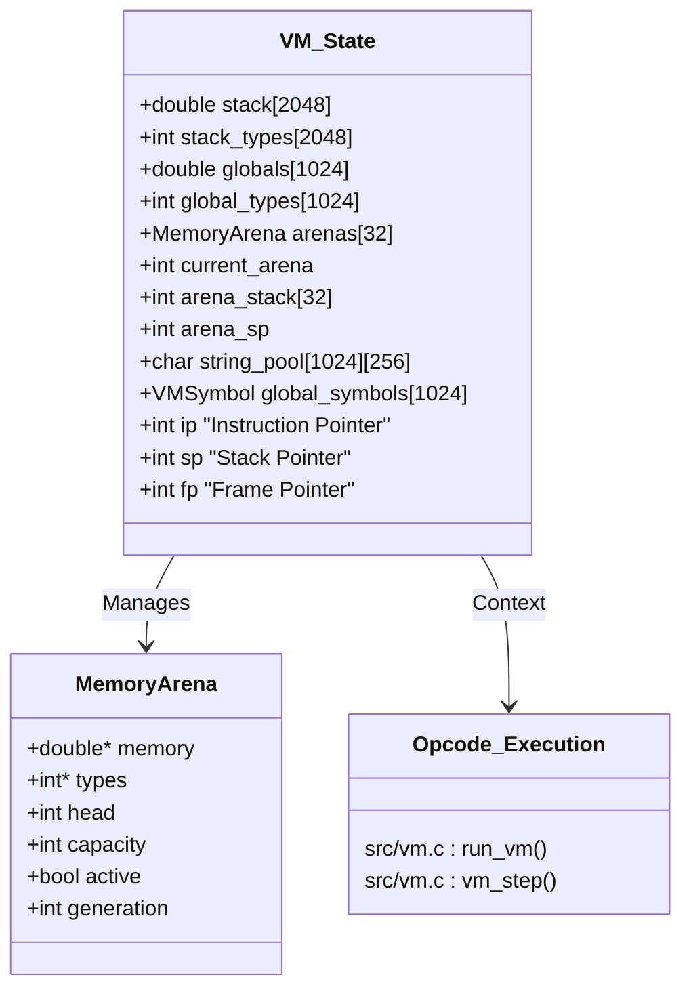
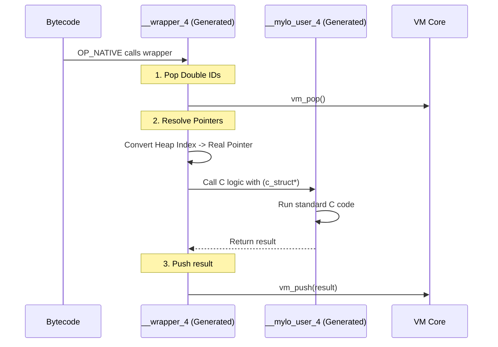

# Mylo Architecture & Internals Reference

## 1. The Virtual Machine (Core Execution)

The Mylo VM is a stack-based, bytecode interpreter optimized for simplicity, low memory overhead, and embedding. It treats the `double` type as the primitive unit of data storage, even for pointers and object handles.

**Key Source Files:** `src/vm.c`, `src/vm.h`, `src/defines.h`

### Memory Model
Unlike many dynamic VMs that use tagged unions or heavy object boxing, Mylo uses a NaN-adjacent packing strategy where values on the stack are represented as `double` values paired with a parallel `vm.stack_types` tracking array.

* **The Stack (`vm.stack`)**: A fixed-size array of `double` (default 2048 entries).
    * *Numeric values* (`i8`..`i64`, `u8`..`u64`, `f32`, `f64`) are stored directly as doubles.
    * *Strings* are stored as integer indices into the deduplicated `string_pool`.
    * *Objects* (Arrays, Maps, Structs) are stored as packed handles into active memory arenas.
* **Generational Memory Arenas (`vm.arenas`)**: An array of fast bump-allocated arenas (`MAX_ARENAS`).
    * **Arena 0 ('main')**: Default global allocation arena.
    * **Lexical Regions**: Scoped arenas created via `region [name] { ... }` blocks.
    * **Persistent Regions**: Named arenas created via `region foo`, allocated via `foo::var`, and destroyed via `clear foo`.
    * **Handles**: Object pointers pack the generation count, arena ID, and memory offset into a single handle to guarantee pointer safety without a tracing garbage collector.
* **Arena Stack (`vm.arena_stack`)**: LIFO stack of active arena IDs (`arena_sp`) allowing arbitrarily nested lexical regions to push and pop allocation contexts seamlessly.
* **String Pool (`vm.string_pool`)**: A lookup table where string literals are deduplicated at compile/load time.



### Execution Loop & Opcode Set
The VM core loop resides in `run_vm()` in `src/vm.c`. Bytecode execution is driven by a `switch (opcode)` loop with stack manipulations managed by `vm_push` and `vm_pop`.

#### Arena & Memory Lifecycle Opcodes

| Opcode | Operand | Description |
|:-------|:--------|:------------|
| `OP_NEW_ARENA_PUSH` | none | Allocates a new inactive arena, sets its active state, pushes its ID onto `vm.arena_stack`, and switches `vm.current_arena`. |
| `OP_PUSH_CTX` | `arena_id` | Pushes the specified arena ID onto `vm.arena_stack` and makes it the active allocation context. |
| `OP_POP_CTX` | none | Pops the current arena ID from `vm.arena_stack` and restores `vm.current_arena` to the parent scope. |
| `OP_FREE_ARENA` | `arena_id` | Frees an arena: marks `active = false`, increments `generation` (invalidating dangling handles), resets `head = 0`, and zeroes memory. |
| `OP_DEL_ARENA` | `arena_id` | Deallocates backing memory buffers for the specified arena. |
| `OP_SET_CTX` | `arena_id` | Directly sets `vm.current_arena` to the specified ID. |
| `OP_MONITOR` | none | Dumps current memory state, active arenas, head offsets, and live global/local symbols to stdout. |

---

## 2. Symbol Lifetime Management & Debugging

Mylo features single-pass symbol lifetime tracking to ensure that debuggers (DAP and CLI) and runtime introspection (`monitor()`) accurately reflect variable visibility across scopes and explicit region destructions.

**Key Source Files:** `src/compiler.c`, `src/vm.h`, `src/vm.c`

### The `VMSymbol` Table
Each global and region symbol is tracked with exact instruction pointer boundaries:

```c
typedef struct {
    char name[MAX_IDENTIFIER];
    int addr;
    int start_ip;
    int end_ip;
} VMSymbol;
```

1. **Symbol Creation:** When a variable or persistent region is declared, the compiler sets `start_ip = code_size`.
2. **Lexical Scope Exit:** When a block or region `{ ... }` closes, the compiler patches `end_ip = code_size` for all symbols local to that scope.
3. **Explicit Teardown (`clear <region>`):** When `clear foo` is encountered, the compiler iterates through all global symbols prefixed with `foo_` (and `foo` itself) and sets `end_ip = code_size - 1`.
4. **Runtime Querying:** When `monitor()` or the debugger inspects variables, it tests whether `vm.ip >= s->start_ip && vm.ip <= s->end_ip`. If `ip` is outside this interval, the variable is hidden, accurately reflecting that its memory and lifetime are closed.

---

## 3. The Object System (Heap Layout)

Since heap memory inside an arena is organized as contiguous `double` buffers, Mylo implements a lightweight object protocol using "Heap Headers".

**Key Source File:** `src/defines.h`, `src/vm.c`

When an object is allocated via `heap_alloc`, it reserves a block of doubles in the current arena. The leading doubles are metadata:

* **Header 0 (Type):** Indicates the object type (`TYPE_ARRAY`, `TYPE_MAP`, `TYPE_BYTES`).
* **Header 1 (Length/Meta):** Length of the array, byte count, or capacity of the map.
* **Body:** The actual payload follows immediately.

**Code Reference (`src/defines.h`):**
```c
#define TYPE_ARRAY -1
#define TYPE_BYTES -2
#define HEAP_OFFSET_TYPE 0
#define HEAP_OFFSET_LEN 1
```

**Example: Array `[10, 20]` in Heap**


---

## 4. The Compiler (Single-Pass Recursive Descent)

Mylo uses a recursive descent parser that emits bytecode directly in a single pass without an Abstract Syntax Tree (AST).

**Key Source File:** `src/compiler.c`

### Pipeline
1.  **Tokenizer:** `next_token()` reads text and populates the `curr` global token.
2.  **Parser:** Functions like `statement()`, `expression()`, and `function()` consume tokens.
3.  **Emitter:** Functions like `emit(OP_ADD)` write directly to `vm.bytecode`.
4.  **Backpatching:** For control flow (`IF`, `FOR`, `region`), the compiler emits placeholder jumps and context switches, recording the addresses and patching them once the target block size is known.

**Code Reference (`src/compiler.c`):**
* `parse()`: Entry point.
* `expression()`: Handles Pratt parsing (precedence) for math and comparisons.
* `region_statement()`: Handles both lexical `region [name] { ... }` blocks and persistent `region foo` declarations.
* `clear_statement()`: Handles `clear foo` and `clear(foo)` statements, emitting `OP_FREE_ARENA` and patching symbol lifetimes.
* `generate_binding_c_source()`: The specialized emitter for `C()` blocks.

---

## 5. The API Bridge & Inline C

This is Mylo's most distinct feature. It allows `C()` blocks inside Mylo code to generate native bindings automatically without external manual wrapping.

**Key Source Files:** `src/compiler.c` (Generation), `src/raylib_binding.mylo_bind.c` (Output)

### How it works
1.  **Extraction:** The compiler detects `C(...)` blocks and `cfn` declarations.
2.  **Dynamic Resolution (Interpreted):** The interpreter attempts to resolve `cfn` symbols directly from the host binary or loaded dynamic libraries (`dlsym`).
3.  **Static Wrapper Generation (`--build` / `--bind`):** The compiler generates a C file (`*_bind.c`) exporting wrappers that translate VM stack values into native C arguments.
4.  **The API Struct:** To avoid linking errors across dynamically loaded modules, the host application passes a `MyloAPI` struct containing function pointers to the VM core (`push`, `pop`, `heap_alloc`, `vm_resolve_ptr`).

**The `MyloAPI` Struct (`src/vm.h`):**
```c
typedef struct {
    void (*push)(double, int);
    double (*pop)();
    int (*heap_alloc)(int);
    double* (*resolve_ptr)(double);
} MyloAPI;
```

### The Shim Layer
The generated C file creates "Wrappers" that translate VM Doubles into C Types.



---

## 6. Standard Library & Hybrids

**Key Source File:** `src/mylolib.c`

Mylo's standard library supports two types of functions:
1.  **Pure Native:** C functions that manipulate the stack directly (e.g., `std_sin`, `std_len`, `std_read_bytes`).
2.  **Hybrid Functions:** C functions that can execute Mylo Bytecode (e.g., `std_for_list`).

### Hybrid Execution (`for_list`)
This pattern allows high-performance looping in C while calling user-defined logic for each item.

1.  **Save State:** The function saves `vm.ip`.
2.  **Setup Frame:** It pushes `vm.code_size` (Magic Return Address), `vm.fp`, and `Args` onto the stack to mimic a function call.
3.  **Hijack Execution:** It calls `run_vm_from(func_addr)`. The VM runs the user's function.
4.  **Magic Return:** When the user function hits `OP_RET`, it pops the IP. Since the IP is `vm.code_size`, the inner `run_vm_from` loop terminates.
5.  **Restore State:** Control returns to C, which restores `vm.ip` and continues.

**Code Reference (`src/mylolib.c`):**
```c
int saved_ip = vm->ip;
vm_push(vm->code_size, T_NUM); // Push Magic Exit
vm_push(vm->fp, T_NUM);        // Push Frame
run_vm_from(addr);             // Run Bytecode
vm->ip = saved_ip;             // Restore
```
